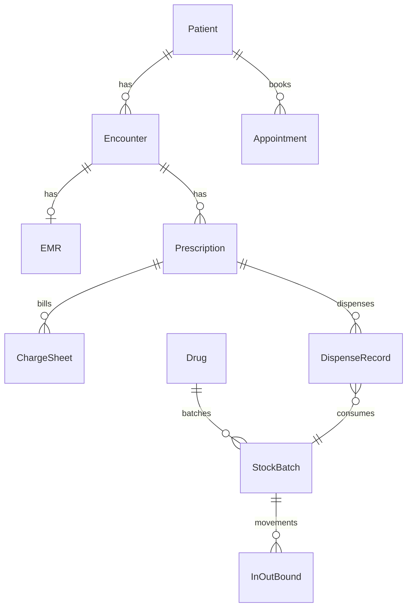
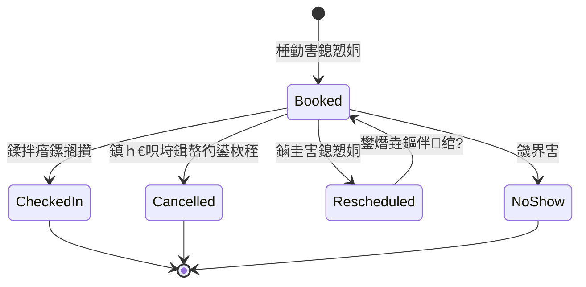
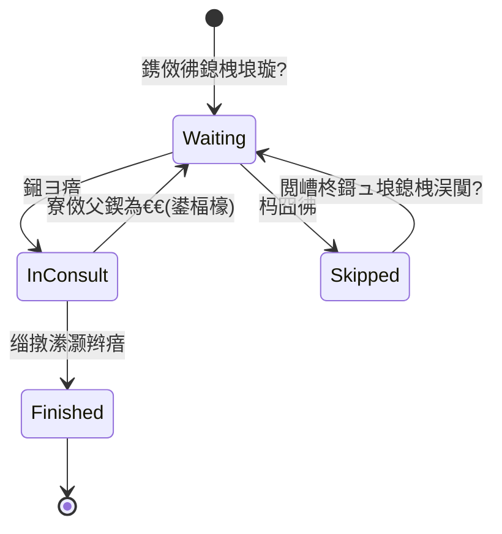
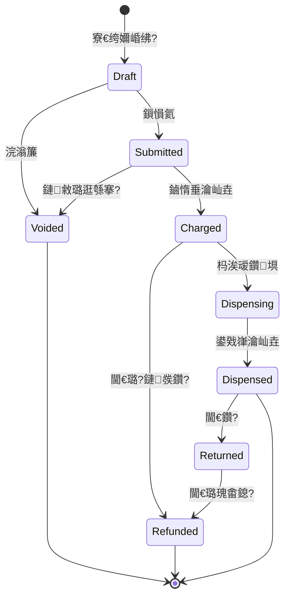
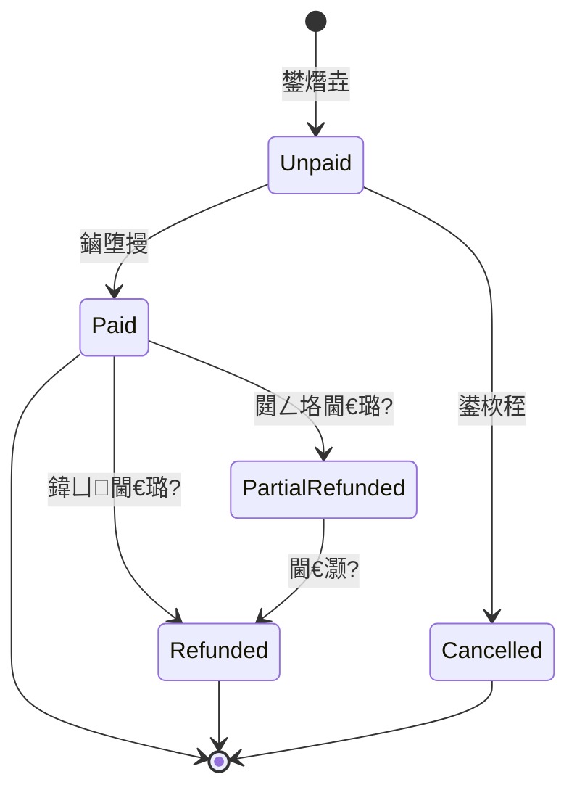

# 璇婃墍绠＄悊绯荤粺 鈥?闇€姹傝鏄庢枃妗ｏ紙SRS 杞婚噺鐗堬級

| 椤?| 鍐呭 |
|---|---|
| 鏂囨。鐗堟湰 | V1.0 |
| 鐘舵€?| 鑽夌 / 鍙瘎瀹?|
| 浜у搧瀹氫綅 | 鍗曞簵璇婃墍鍐呴儴绠＄悊绯荤粺锛堣交閲?HIS锛?|
| 閫傜敤瀵硅薄 | 浜у搧銆佺爺鍙戙€佹祴璇曘€佽瘖鎵€杩愯惀璐熻矗浜?|
| 缂栧啓鏃ユ湡 | 2026-10-08 |
| 鍏宠仈鑼冨洿 | 绾夸笅鍒板簵闂ㄨ瘖闂幆锛涗笉鍚浘鏂?瑙嗛闂瘖銆佸闄㈠尯杩為攣銆佷綇闄㈡墜鏈€佸鏉傚尰淇濇竻绠?|

---

## 1. 鏂囨。淇℃伅

### 1.1 淇璁板綍

| 鐗堟湰 | 鏃ユ湡 | 璇存槑 | 浣滆€?|
|---|---|---|---|
| V1.0 | 2026-10-08 | 棣栫増锛氭寜銆孊 璇婃墍鍐呴儴绠＄悊 + 鍗曞簵 + 鏃犺繙绋嬮棶璇娿€嶆暣鐞嗗畬鏁撮渶姹?| 鈥?|

### 1.2 鏈琛?

| 鏈 | 璇存槑 |
|---|---|
| 鍙锋簮 | 鏌愬尰鐢?绉戝鍦ㄦ煇鏃舵鍙绾︽垨鍙寕鍙风殑鍚嶉 |
| 鍒拌瘖鏍搁攢 | 棰勭害鎮ｈ€呭埌杈捐瘖鎵€鍚庯紝鍓嶅彴纭鍒拌瘖骞惰浆鍏ュ€欒瘖/灏辫瘖娴佺▼ |
| 鎺ヨ瘖 | 鍖荤敓寮€濮嬩负鎮ｈ€呰瘖鐤楋紝鎵撳紑/鍒涘缓鏈闂ㄨ瘖鐥呭巻 |
| 瀹℃柟 | 鑽笀瀵瑰鏂瑰悎鐞嗘€с€佸簱瀛樺彲閰嶆€ц繘琛屽鏍?|
| 鍙戣嵂 | 鑽笀鎸夊凡鏀惰垂涓斿凡瀹℃柟锛堟垨鍏嶅閰嶇疆锛夌殑澶勬柟閰嶅彂鑽搧骞舵墸鍑忓簱瀛?|
| 鏃ョ粨 | 璐㈠姟鎸夋棩姹囨€绘敹閾躲€侀€€璐逛笌鏀惰垂鏂瑰紡锛屽畬鎴愬璐﹂攣瀹?|
| 杩戞晥鏈?| 鑽搧璺濆け鏁堟棩鏈熶笉瓒抽厤缃槇鍊硷紙濡?90/180 澶╋級 |
| MVP | 鏈€灏忓彲涓婄嚎鐗堟湰锛屾敮鎾戝崟搴楅棬璇婁富闂幆 |

### 1.3 鑼冨洿杈圭晫锛堟湰鏈熸槑纭笉鍋氾級

- 澶氶櫌鍖?/ 杩為攣闆嗗洟绠＄悊銆佽法搴楄皟鎷ㄤ笌缁熶竴缁撶畻
- 浣忛櫌銆佹墜鏈夯閱夈€佺梾鍖烘姢鐞?
- 鍥炬枃闂瘖銆佽棰戦棶璇娿€佷簰鑱旂綉璇婄枟澶勬柟娴佽浆
- 澶嶆潅鍖讳繚娓呯畻銆佸晢淇濈洿杩烇紙鍙鐣欐墿灞曠偣锛?
- 绗笁鏂硅嵂鍝佺數鍟嗐€佹偅鑰呯璐嵂鍟嗗煄
- 澶嶆潅鍙彿澶у睆纭欢娣卞害瀵规帴锛堟湰鏈熶粎杞婚噺鍙彿锛?

---

## 2. 椤圭洰姒傝堪

### 2.1 鑳屾櫙

涓皬鍨嬪崟搴楄瘖鎵€淇℃伅鍖栫▼搴﹀弬宸紝甯歌鐥涚偣鍖呮嫭锛氶绾︿笌鐜板満鎸傚彿鍓茶銆佺梾鍘嗘墜鍐欓毦杩芥函銆佹敹璐逛笌鍙戣嵂涓嶅悓姝ャ€佸簱瀛樹笌鏁堟湡闅剧鎺с€佽鑹叉潈闄愪笌鎿嶄綔瀹¤缂哄け銆傞渶瑕佷竴濂椾互鍖绘姢/琛屾斂涓轰富銆佹偅鑰呯杞婚噺鍙備笌鐨勫唴閮ㄧ鐞嗙郴缁燂紝鎵撻€氥€岄绾?鈫?鍒拌瘖 鈫?鎺ヨ瘖寮€鏂?鈫?鏀惰垂 鈫?鍙戣嵂 鈫?鐥呭巻褰掓。銆嶏紝骞跺苟琛屾敮鎾戣繘閿€瀛樸€?

### 2.2 浜у搧鐩爣

1. 鏀拺鍗曞簵鏃ュ父闂ㄨ瘖鍏ㄦ祦绋嬫暟瀛楀寲锛屽噺灏戠焊璐ㄥ崟鎹笌鍙ｅご浜ゆ帴銆?
2. 淇濊瘉澶勬柟銆佹敹璐广€佸簱瀛樹笁鑰呯姸鎬佷竴鑷达紝闄嶄綆婕忔敹銆佹紡鎵ｃ€侀敊鍙戦闄┿€?
3. 寤虹珛鎮ｈ€呮。妗堜笌灏辫瘖鍙诧紝鎻愬崌澶嶈瘖鏁堢巼涓庣敤鑽畨鍏紙杩囨晱/閲嶅鐢ㄨ嵂鎻愮ず鍒嗛樁娈佃惤鍦帮級銆?
4. 鎻愪緵鍩虹缁忚惀鎶ヨ〃涓庤嵂鍝佹晥鏈?搴撳瓨棰勮锛岃緟鍔╄繍钀ュ喅绛栥€?
5. 浠ヨ鑹叉潈闄愪笌瀹¤鏃ュ織婊¤冻鐥呭巻闅愮涓庢搷浣滃彲杩芥函鐨勫熀鏈悎瑙勮姹傘€?

### 2.3 鎴愬姛鏍囧噯锛堝彲楠屾敹锛?

| 缂栧彿 | 鎴愬姛鏍囧噯 |
|---|---|
| S1 | 鎮ｈ€呭彲瀹屾垚棰勭害/鏀圭害/鍙栨秷锛涘墠鍙板彲鐜板満鎸傚彿涓庡埌璇婃牳閿€ |
| S2 | 鍖荤敓鍙畬鎴愭帴璇娿€佸啓鐥呭巻銆佸紑绔嬭タ鑽鏂瑰苟鎵撳嵃/瀵煎嚭 |
| S3 | 鏀惰垂鍚庤嵂鎴垮彲鍙戣嵂锛屽彂鑽嚜鍔ㄦ墸鍑忓簱瀛橈紱搴撳瓨涓嶈冻鏈夋槑纭樆鏂垨鎻愮ず绛栫暐 |
| S4 | 搴撶鍙畬鎴愰噰璐叆搴撱€佺洏鐐广€佽繎鏁堟湡棰勮鏌ヨ |
| S5 | 涓嶅悓瑙掕壊浠呰兘璁块棶鎺堟潈鑿滃崟涓庢暟鎹紱鍏抽敭鎿嶄綔鏈夊璁¤褰?|
| S6 | MVP 涓婄嚎鍚庯紝闂ㄨ瘖涓婚棴鐜棤闇€渚濊禆绾夸笅鍙拌处鍗冲彲鏃ユ竻 |

### 2.4 鐢ㄦ埛涓庝娇鐢ㄥ満鏅紙鎽樿锛?

- **鍓嶅彴**锛氭寕鍙枫€佹牳閿€棰勭害銆佸紩瀵煎€欒瘖銆佸崗鍔╁缓妗ｃ€?
- **鍖荤敓**锛氬彨鍙锋帴璇娿€佺梾鍘嗐€佸紑鏂广€佹煡闃呭巻鍙层€?
- **鑽笀**锛氬鏂广€佸彂鑽€侀€€鑽€佺己鑽鐞嗐€?
- **搴撶**锛氬叆搴撱€佺洏鐐广€佹晥鏈熶笌涓婁笅闄愮鐞嗐€?
- **璐㈠姟**锛氭敹閾躲€侀€€璐广€佹棩缁撱€佹敹鍏ユ煡璇€?
- **绠＄悊鍛?*锛氳处鍙疯鑹层€佸熀纭€瀛楀吀銆佹帓鐝鍒欍€佺郴缁熷弬鏁般€?
- **鎮ｈ€咃紙杞婚噺绔級**锛氶绾︽寕鍙枫€佹敼绾?鍙栨秷銆佹煡鐪嬫姤鍛婁笌璐﹀崟鎽樿锛堟姤鍛婃煡鐪嬪彲鏀?V1.1锛夈€?

---

## 3. 鐢ㄦ埛涓庤鑹?

| 瑙掕壊 | 涓昏鑱岃矗 | 鍏稿瀷鏉冮檺 |
|---|---|---|
| 鎮ｈ€咃紙C 绔交锛?| 棰勭害/鏀圭害/鍙栨秷锛涙煡鐪嬫湰浜鸿处鍗曟憳瑕併€佹姤鍛婏紙鍒嗘湡锛?| 浠呮湰浜烘暟鎹?|
| 鍓嶅彴 | 寤烘。銆佺幇鍦烘寕鍙枫€侀绾︽牳閿€銆佸垎璇婅緟鍔┿€佸熀纭€鍜ㄨ鐧昏 | 鎮ｈ€呮。妗堛€佹寕鍙烽绾︺€佸€欒瘖闃熷垪鍙/鎿嶄綔 |
| 鎶ゅ＋/鍒嗚瘖 | 鍊欒瘖闃熷垪缁存姢銆佸彨鍙峰崗鍔┿€佺敓鍛戒綋寰佸綍鍏ワ紙鍙€夛級 | 闂ㄨ瘖闃熷垪銆佹偅鑰呭熀鏈俊鎭?|
| 鍖荤敓 | 鎺ヨ瘖銆佺梾鍘嗐€佽瘖鏂€佸紑鏂广€佸巻鍙茶皟闃?| 鏈瀹?鏈汉鍙锋簮鐩稿叧灏辫瘖锛涚梾鍘嗗鏂?|
| 鑽笀 | 瀹℃柟銆佸彂鑽€侀€€鑽€佸鏂规煡璇?| 鑽埧銆佸簱瀛樺彧璇汇€佸鏂圭姸鎬?|
| 搴撶 | 渚涘簲鍟嗐€佸叆搴?閫€璐с€佺洏鐐广€侀璀﹀鐞?| 杩涢攢瀛樺叏閲忥紙鍗曞簵锛?|
| 璐㈠姟 | 鏀惰垂銆侀€€璐广€佹棩缁撱€佹敹璐归」鐩淮鎶わ紙鍙笌绠＄悊鍛樺垎鎷咃級 | 鏀惰垂銆佹姤琛ㄨ储鍔¤鍥?|
| 璇婃墍绠＄悊鍛?| 缁勭粐璐﹀彿銆佽鑹叉潈闄愩€佸熀纭€鏁版嵁銆佺郴缁熷弬鏁般€佸璁℃煡闃?| 绯荤粺閰嶇疆绫诲叏鏉冮檺锛堜笟鍔℃搷浣滃彲鎸夐渶鍏煎矖锛?|

璇存槑锛氬崟搴楀厑璁镐竴浜哄瑙掕壊锛涙潈闄愭寜銆岃鑹插苟闆嗐€嶇敓鏁堛€?

---

## 4. 涓氬姟鎬昏

### 4.1 闂ㄨ瘖涓婚棴鐜?

```mermaid
flowchart LR
  subgraph patientLight [鎮ｈ€呯杞婚噺]
    Appt[棰勭害鏀圭害]
    Report[鏌ユ姤鍛婅处鍗昡
  end
  subgraph clinicCore [璇婃墍绔牳蹇僝
    Front[鍓嶅彴鎸傚彿鍒嗚瘖]
    EMR[鐢靛瓙鐥呭巻澶勬柟]
    Charge[鏀惰垂閫€璐筣
    Pharmacy[鑽埧鍙戣嵂]
    Patient[鎮ｈ€呮。妗圿
    Inventory[杩涢攢瀛榏
  end
  Appt --> Front
  Front --> EMR
  EMR --> Charge
  Charge --> Pharmacy
  EMR --> Patient
  Pharmacy --> Inventory
  Inventory --> Pharmacy
```

### 4.2 绔埌绔富娴佺▼锛堟枃瀛楋級

1. 绠＄悊鍛樼淮鎶ょ瀹ゃ€佸尰鐢熴€佽嵂鍝佸瓧鍏搞€佹敹璐归」鐩€佹帓鐝彿婧愩€?
2. 鎮ｈ€呯棰勭害锛屾垨鍒板簵鐢卞墠鍙扮幇鍦烘寕鍙凤紱棰勭害鎮ｈ€呭埌搴楀悗鏍搁攢鍒拌瘖銆?
3. 鎮ｈ€呰繘鍏ュ€欒瘖闃熷垪锛涘尰鐢熷彨鍙?鎺ヨ瘖锛屼功鍐欓棬璇婄梾鍘嗗苟寮€绔嬪鏂广€?
4. 鍓嶅彴/璐㈠姟鎸夋寕鍙疯垂銆佽瘖鐤楄垂銆佽嵂鍝佽垂绛夌敓鎴愭敹璐瑰崟骞舵敹閾躲€?
5. 鑽笀瀹℃柟锛堝彲閰嶇疆鏄惁寮哄埗锛夊悗鍙戣嵂锛岀郴缁熸寜鎵规绛栫暐鎵ｅ噺搴撳瓨銆?
6. 鐥呭巻褰掓。锛涘簱绠″苟琛屽鐞嗗叆搴撱€佺洏鐐逛笌鏁堟湡棰勮锛涜储鍔℃棩缁堢粨璐︺€?

### 4.3 鍏抽敭涓氬姟瑙勫垯锛堝叏灞€锛?

| 缂栧彿 | 瑙勫垯 |
|---|---|
| G1 | 涓€鍒囪瘖鐤楄涓哄繀椤诲叧鑱斻€屾偅鑰呮。妗?+ 鏈灏辫瘖锛圗ncounter锛夈€?|
| G2 | 鏈敹璐瑰鏂归粯璁や笉鍙彂鑽紙绱ф€?greencode 闇€绠＄悊鍛橀厤缃笖瀹¤锛?|
| G3 | 鍙戣嵂鎴愬姛蹇呴』浜х敓鍑哄簱娴佹按锛涢€€鑽垚鍔熷繀椤诲洖婊氭垨鍐叉搴撳瓨 |
| G4 | 鐥呭巻涓庡鏂逛竴缁忋€屾彁浜?绛惧彂銆嶅悗鐨勪慨鏀归渶鐣欑棔锛堣皝銆佷綍鏃躲€佹敼浜嗕粈涔堬級 |
| G5 | 鍗曞簵妯″瀷锛氱粍缁囧彧鏈変竴涓瘖鎵€涓讳綋锛屽簱瀛樹负涓€涓€昏緫搴撴埧锛堝彲鐗╃悊鍒嗗尯瀛楁棰勭暀锛?|

---

## 5. 鍔熻兘闇€姹?

> 鍚勬ā鍧楃粨鏋勶細鐩爣 鈫?鍔熻兘鍒楄〃 鈫?鍏抽敭瑙勫垯 鈫?闈炲姛鑳借鐐癸紙濡傛湁锛夈€?

### 5.1 鎮ｈ€呯鐞?

**鐩爣**锛氬缓绔嬪彲澶嶇敤鐨勬偅鑰呬富绱㈠紩锛屾敮鎾戝璇婁笌鐢ㄨ嵂瀹夊叏淇℃伅娌夋穩銆?

**鍔熻兘鍒楄〃**

| ID | 鍔熻兘鐐?| 璇存槑 | 鍒嗘湡 |
|---|---|---|---|
| P-01 | 鎮ｈ€呭缓妗?| 濮撳悕銆佹€у埆銆佸嚭鐢熸棩鏈?骞撮緞銆佹墜鏈哄彿銆佽瘉浠跺彿锛堝彲閫夛級銆佸湴鍧€绛?| MVP |
| P-02 | 鎮ｈ€呮煡璇?| 鎸夊鍚?鎵嬫満鍙?璇佷欢鍙?妗ｆ鍙锋ā绯婃绱?| MVP |
| P-03 | 妗ｆ缂栬緫 | 鍩烘湰淇℃伅缁存姢锛涘叧閿瓧娈靛彉鏇村彲瀹¤ | MVP |
| P-04 | 杩囨晱鍙?/ 鎱㈢梾鍙?| 缁撴瀯鍖栨潯鐩?+ 澶囨敞锛涙帴璇婁笌寮€鏂规椂灞曠ず | MVP |
| P-05 | 灏辫瘖鍙?| 鎸夋椂闂村垪鍑哄巻鍙插氨璇娿€佽瘖鏂憳瑕併€佸鏂规憳瑕佸叆鍙?| MVP |
| P-06 | 瀹跺睘/鑱旂郴浜?| 绱ф€ヨ仈绯讳汉濮撳悕涓庣數璇?| MVP |
| P-07 | 澶囨敞涓庨粦鍚嶅崟鏍囪 | 鍐呴儴澶囨敞锛涢粦鍚嶅崟鎮ｈ€呴绾?鎸傚彿寮烘彁绀?| MVP |
| P-08 | 妗ｆ鍚堝苟 | 閲嶅妗ｆ鍚堝苟锛堜富浠庨€夋嫨銆佸氨璇婅褰曡縼绉伙級 | V1.1 |

**鍏抽敭瑙勫垯**

- 鍚屼竴鎵嬫満鍙峰厑璁稿妗ｆ鏃堕』寮烘彁绀虹枒浼奸噸澶嶏紙濮撳悕+鎵嬫満鍙峰啿绐侊級銆?
- 榛戝悕鍗曚笉鐗╃悊鍒犻櫎鏁版嵁锛屼粎闄愬埗鎴栨彁绀轰笟鍔℃搷浣溿€?
- 鎮ｈ€呯浠呰兘鏌ョ湅鏈汉鎺堟潈鑼冨洿鍐呯殑鎽樿淇℃伅銆?

**闈炲姛鑳借鐐?*锛氭偅鑰呮晱鎰熷瓧娈碉紙璇佷欢鍙枫€佹墜鏈哄彿锛夊垪琛ㄩ〉鑴辨晱灞曠ず銆?

---

### 5.2 棰勭害鎸傚彿

**鐩爣**锛氱粺涓€鍙锋簮锛岃鐩栫嚎涓婇绾︿笌鐜板満鎸傚彿锛屾敮鎸佸埌璇婃牳閿€涓庣埥绾︾粺璁°€?

**鍔熻兘鍒楄〃**

| ID | 鍔熻兘鐐?| 璇存槑 | 鍒嗘湡 |
|---|---|---|---|
| A-01 | 鎺掔彮绠＄悊 | 鎸夊尰鐢?绉戝閰嶇疆鍑鸿瘖鏃ユ湡銆佹椂娈点€佸彿婧愭暟閲?| MVP |
| A-02 | 鍙锋簮鐢熸垚涓庡喕缁?| 鏍规嵁鎺掔彮鐢熸垚鍙害鍙凤紱鏀寔鍋滆瘖鍐荤粨鍙锋簮 | MVP |
| A-03 | 鎮ｈ€呯棰勭害 | 閫夌瀹?鍖荤敓/鏃舵涓嬪崟棰勭害 | MVP |
| A-04 | 鏀圭害 / 鍙栨秷 | 鍦ㄨ鍒欏厑璁告椂闄愬唴鏀圭害鎴栧彇娑堝苟閲婃斁鍙锋簮 | MVP |
| A-05 | 鐜板満鎸傚彿 | 鍓嶅彴閫夋嫨鍙锋簮鎴栧姞鍙风瓥鐣ュ畬鎴愭寕鍙?| MVP |
| A-06 | 鍒拌瘖鏍搁攢 | 棰勭害鍗曟牳閿€涓哄凡鍒拌瘖骞惰繘鍏ュ€欒瘖 | MVP |
| A-07 | 鐖界害澶勭悊 | 杩囧彿鏈埌鑷姩/鎵嬪姩璁扮埥绾︼紱鍙粺璁?| MVP |
| A-08 | 棰勭害鏌ヨ | 褰撴棩/鍘嗗彶棰勭害鍒楄〃绛涢€?| MVP |

**鍏抽敭瑙勫垯**

- 鍚屼竴鎮ｈ€呭悓涓€鍖荤敓鍚屼竴鏃舵涓嶅彲閲嶅鏈夋晥棰勭害锛堝彲閰嶇疆锛夈€?
- 鍙栨秷/鏀圭害鎴鏃堕棿鍙厤缃紙濡傚氨璇婂墠 N 灏忔椂锛夈€?
- 鍙锋簮鎵ｅ噺涓庨噴鏀惧繀椤诲師瀛愶細棰勭害鎴愬姛鍗犲彿锛屽彇娑?鐖界害/杩囨湡閲婃斁銆?
- 鍔犲彿闇€鏈夋潈闄愯鑹叉搷浣滐紝骞惰鍏ュ綋鏃ラ棬璇婇噺銆?

---

### 5.3 闂ㄨ瘖灏辫瘖锛堝€欒瘖 / 鍙彿锛?

**鐩爣**锛氳交閲忕鐞嗗€欒瘖闃熷垪涓庢帴璇婄姸鎬侊紝涓嶅仛澶嶆潅纭欢澶у睆瀵规帴銆?

**鍔熻兘鍒楄〃**

| ID | 鍔熻兘鐐?| 璇存槑 | 鍒嗘湡 |
|---|---|---|---|
| V-01 | 鍊欒瘖闃熷垪 | 鎸夌瀹?鍖荤敓灞曠ず寰呰瘖銆佽瘖涓€佸凡璇?| MVP |
| V-02 | 鍙彿 / 杩囧彿 | 鍖荤敓鎴栧垎璇婂彨涓嬩竴浣嶏紱杩囧彿鍙洖闃熷熬鎴栨爣璁?| MVP |
| V-03 | 鎺ヨ瘖寮€濮?缁撴潫 | 鍙樻洿灏辫瘖鐘舵€侊紱鍏宠仈鐥呭巻浼氳瘽 | MVP |
| V-04 | 闃熷垪绛涢€?| 鎸夌姸鎬併€佸叧閿瓧杩囨护 | MVP |

**鍏抽敭瑙勫垯**

- 浠呫€屽凡鍒拌瘖/宸叉寕鍙枫€嶈繘鍏ュ€欒瘖銆?
- 鍚屼竴灏辫瘖鍚屾椂鍙兘琚竴浣嶅尰鐢熸帴璇婏紙閿佸畾鎴栫姸鎬佷簰鏂ワ級銆?
- 杩囧彿绛栫暐鍙厤缃細鍥為槦灏?/ 闇€閲嶆柊鎶ュ埌銆?

---

### 5.4 鐢靛瓙鐥呭巻

**鐩爣**锛氭敮鎾戦棬璇婄梾鍘嗕功鍐欍€佸巻鍙茶皟闃呬笌鎵撳嵃瀵煎嚭銆?

**鍔熻兘鍒楄〃**

| ID | 鍔熻兘鐐?| 璇存槑 | 鍒嗘湡 |
|---|---|---|---|
| E-01 | 鍒涘缓/缂栬緫闂ㄨ瘖鐥呭巻 | 涓昏瘔銆佺幇鐥呭彶銆佹棦寰€鍙层€佹煡浣撱€佽瘖鏂€佸缃缓璁瓑 | MVP |
| E-02 | 甯哥敤璇婃柇搴?| 鑷敱鏂囨湰 + 甯哥敤璇婃柇閫夋嫨锛汭CD 缂栫爜鍙厛鍙€夊～ | MVP |
| E-03 | 鍘嗗彶鐥呭巻璋冮槄 | 鍙鏌ョ湅鍘嗗彶灏辫瘖鐥呭巻 | MVP |
| E-04 | 鐥呭巻鎻愪氦/褰掓。 | 鎻愪氦鍚庨檺鍒堕殢鎰忕鏀癸紝淇敼鐣欑棔 | MVP |
| E-05 | 鎵撳嵃 / 瀵煎嚭 PDF | 鐥呭巻鎵撳嵃妯℃澘 | MVP |
| E-06 | 鐥呭巻妯℃澘 | 鎸夌瀹?鐥呯妯℃澘涓€閿甫鍏?| V1.1 |
| E-07 | ICD 缂栫爜澧炲己 | 璇婃柇缂栫爜妫€绱笌蹇呭～绛栫暐鍙厤缃?| V1.1 |

**鍏抽敭瑙勫垯**

- 涓€浠藉氨璇婂搴斾竴浠戒富鐥呭巻锛堝彲鍏佽澶氭缂栬緫鑷虫彁浜わ級銆?
- 褰掓。鍚庝慨鏀归渶璁板綍淇鐗堟湰鎴栧彉鏇存棩蹇椼€?
- 浠呮帴璇婂尰鐢熷強鎺堟潈瑙掕壊鍙紪杈戞湭褰掓。鐥呭巻銆?

**闈炲姛鑳借鐐?*锛氱梾鍘嗚闂啓鍏ュ璁★紱瀵煎嚭鎿嶄綔鍙鏃ュ織銆?

---

### 5.5 澶勬柟涓庡尰鍢?

**鐩爣**锛氳タ鑽鏂瑰紑绔嬩笌鐘舵€佹祦杞紝涓烘敹璐瑰拰鍙戣嵂鎻愪緵渚濇嵁銆?

**鍔熻兘鍒楄〃**

| ID | 鍔熻兘鐐?| 璇存槑 | 鍒嗘湡 |
|---|---|---|---|
| RX-01 | 寮€绔嬭タ鑽鏂?| 鑽搧銆佽鏍笺€佹暟閲忋€佺敤娉曘€侀娆°€佸ぉ鏁般€佸槺鎵?| MVP |
| RX-02 | 澶勬柟淇濆瓨/鎻愪氦 | 鑽夌涓庢彁浜わ紱鎻愪氦鍚庤繘鍏ュ緟鏀惰垂 | MVP |
| RX-03 | 澶勬柟浣滃簾 | 鏈敹璐瑰彲浣滃簾锛涘凡鏀惰垂璧伴€€璐归€€鑽摼璺?| MVP |
| RX-04 | 澶勬柟鏌ヨ | 鎸夋偅鑰?鏃ユ湡/鐘舵€佹煡璇?| MVP |
| RX-05 | 杩囨晱鍐茬獊鎻愮ず | 寮€鏂规椂瀵圭収鎮ｈ€呰繃鏁忓彶鎻愮ず | V1.1 |
| RX-06 | 閲嶅鐢ㄨ嵂鎻愮ず | 鍚屾垚鍒?鍚岃嵂鍝佽繎鏈熼噸澶嶆彁绀?| V1.1 |

**鍏抽敭瑙勫垯**

- 澶勬柟鏄庣粏鑽搧蹇呴』鏉ヨ嚜鑽搧瀛楀吀涓旂姸鎬佸惎鐢ㄣ€?
- 搴撳瓨涓?0 鏃讹細寮€鏂瑰彲鎻愮ず锛涘彂鑽樁娈靛己鏍￠獙锛堣鑽埧/杩涢攢瀛橈級銆?
- 澶勬柟鐘舵€佽闄勫綍鐘舵€佹満锛涗笉鍏佽璺宠繃闈炴硶娴佽浆銆?

---

### 5.6 鏀惰垂绠＄悊

**鐩爣**锛氬畬鎴愭寕鍙疯垂/璇婄枟璐?鑽搧璐圭瓑鏀堕摱銆侀€€璐逛笌鏃ョ粨銆?

**鍔熻兘鍒楄〃**

| ID | 鍔熻兘鐐?| 璇存槑 | 鍒嗘湡 |
|---|---|---|---|
| C-01 | 鏀惰垂椤圭洰瀛楀吀 | 椤圭洰缂栫爜銆佸悕绉般€佸崟浠枫€佺被鍨嬶紙鎸傚彿/璇婄枟/鍏朵粬锛?| MVP |
| C-02 | 鐢熸垚鏀惰垂鍗?| 姹囨€绘寕鍙枫€佽瘖鐤椼€佸鏂硅嵂鍝侀噾棰?| MVP |
| C-03 | 鏀堕摱 | 鐜伴噾/寰俊/鏀粯瀹?閾惰鍗＄瓑锛堝彲閰嶇疆鏀粯鏂瑰紡锛?| MVP |
| C-04 | 鏀惰垂鏌ヨ涓庣エ鎹墦鍗?| 鏀惰垂璁板綍鏌ヨ銆佺畝鏄撴敹鎹墦鍗?| MVP |
| C-05 | 閮ㄥ垎/鍏ㄩ閫€璐?| 涓庨€€鑽仈鍔紱闇€鏉冮檺 | V1.1 |
| C-06 | 鏃ョ粨 | 鎸夋棩姹囨€汇€佸璐︺€侀攣瀹氬綋鏃ユ敹閾?| V1.1 |
| C-07 | 鎮ｈ€呯璐﹀崟鎽樿 | 鎮ｈ€呮煡鐪嬫湰浜哄凡鏀粯璐﹀崟鎽樿 | V1.1 |

**鍏抽敭瑙勫垯**

- 宸插叏棰濋€€璐圭殑鏀惰垂鍗曚笉鍙噸澶嶆敹璐癸紱閮ㄥ垎閫€璐瑰悗浣欓鍙窡韪€?
- 鏃ョ粨閿佸畾鍚庡綋鏃ュ崟鎹皟鏁撮渶鍙嶆棩缁撴潈闄愩€?
- 鏀惰垂鎴愬姛鏄彂鑽殑鍓嶇疆鏉′欢锛堥櫎闈炵揣鎬?greencode锛夈€?

---

### 5.7 鑽埧绠＄悊

**鐩爣**锛氬鏂广€佸彂鑽€侀€€鑽笌缂鸿嵂澶勭悊锛屼繚璇佽处瀹炰竴鑷淬€?

**鍔熻兘鍒楄〃**

| ID | 鍔熻兘鐐?| 璇存槑 | 鍒嗘湡 |
|---|---|---|---|
| PH-01 | 寰呭彂鑽槦鍒?| 宸叉敹璐瑰緟鍙戣嵂澶勬柟鍒楄〃 | MVP |
| PH-02 | 瀹℃柟 | 閫氳繃/椹冲洖鍙婂師鍥狅紱鍙厤缃槸鍚﹁烦杩囧鏂?| MVP |
| PH-03 | 鍙戣嵂 | 纭瀹炲彂鏁伴噺锛涙墸搴撳瓨锛涙墦鍗拌嵂绛撅紙鍙€夛級 | MVP |
| PH-04 | 缂鸿嵂澶勭悊 | 缂鸿嵂鏍囪銆侀€氱煡鍖荤敓鏀规柟鎴栭€€璐?| MVP |
| PH-05 | 澶勬柟鏌ヨ | 鍘嗗彶鍙戣嵂璁板綍 | MVP |
| PH-06 | 閫€鑽?| 宸插彂鑽€€鍥烇紝鍐叉搴撳瓨骞惰Е鍙戦€€璐规祦绋?| V1.1 |

**鍏抽敭瑙勫垯**

- 鍙戣嵂鏁伴噺涓嶅緱瓒呰繃澶勬柟鏁伴噺锛涢儴鍒嗗彂鑽瓥鐣ワ細MVP 鍙姹傛暣鏂瑰彂瀹屾垨鏁存柟鎸傝捣锛孷1.1 鍐嶆敮鎸佺粏绮掑害銆?
- 鍙戣嵂鎵ｅ噺榛樿鎸夎繎鏁堟湡浼樺厛锛團EFO锛夋垨鎵规鎵嬪伐閫夋嫨锛堝彲閰嶇疆锛夈€?
- 閫€鑽繀椤诲叧鑱斿師鍙戣嵂鍗曪紝闃叉鏃犲崟鍥炲簱銆?

---

### 5.8 杩涢攢瀛?

**鐩爣**锛氬崟搴楄嵂鍝佽繘閿€瀛橀棴鐜紝鏀拺鍙戣嵂鎵ｅ噺涓庢晥鏈熼闄╂帶鍒躲€?

**鍔熻兘鍒楄〃**

| ID | 鍔熻兘鐐?| 璇存槑 | 鍒嗘湡 |
|---|---|---|---|
| I-01 | 渚涘簲鍟嗙鐞?| 渚涘簲鍟嗘。妗堝惎鐢?鍋滅敤 | MVP |
| I-02 | 閲囪喘鍏ュ簱 | 鍏ュ簱鍗曪細鑽搧銆佹壒娆°€佹晥鏈熴€佹暟閲忋€佽繘浠?| MVP |
| I-03 | 搴撳瓨鏌ヨ | 瀹炴椂搴撳瓨銆佹壒娆″簱瀛?| MVP |
| I-04 | 鍑哄叆搴撴祦姘?| 鍙戣嵂鍑哄簱銆佸叆搴撱€佺洏鐩堢洏浜忋€侀€€鑽洖搴撶瓑 | MVP |
| I-05 | 鐩樼偣 | 鐩樼偣鍗曘€佸樊寮傝皟鏁?| MVP |
| I-06 | 杩戞晥鏈?/ 涓婁笅闄愰璀?| 鍒楄〃涓庨椤垫彁閱?| MVP |
| I-07 | 閲囪喘閫€璐?| 閫€璐у嚭搴撳啿鍑忔壒娆″簱瀛?| V1.1 |
| I-08 | 璋冩嫧 | 鍗曞簵寮卞寲锛涘悓搴楀簱鍖鸿皟鎷ㄥ彲閫?| 鍚庣画 |

**鍏抽敭瑙勫垯**

- 鎵规 + 鏁堟湡涓哄簱瀛樻渶灏忕鐞嗗崟鍏冦€?
- 涓嶅厑璁歌礋搴撳瓨鍙戣嵂锛堝彲閰嶇疆锛氱姝?/ 浠呯鐞嗗憳寮哄埗骞跺璁★級銆?
- 鐩樼偣閿佸畾鏈熼棿闄愬埗瀵圭洏鐐硅嵂鍝佺殑骞跺彂鍑哄簱锛堟垨閲囩敤涔愯鏍￠獙锛夈€?

---

### 5.9 鍩虹鏁版嵁

**鐩爣**锛氭敮鎾戜笟鍔¤繍琛岀殑涓绘暟鎹淮鎶ゃ€?

| ID | 鍔熻兘鐐?| 璇存槑 | 鍒嗘湡 |
|---|---|---|---|
| M-01 | 绉戝 / 璇婂 | 缁勭粐灏辫瘖鍗曞厓 | MVP |
| M-02 | 鍖荤敓妗ｆ | 鍏宠仈璐﹀彿銆佺瀹ゃ€佹搮闀裤€佹槸鍚﹀嚭璇?| MVP |
| M-03 | 鑽搧瀛楀吀 | 閫氱敤鍚嶃€佽鏍笺€佸崟浣嶃€侀浂鍞环銆佹垚鏈环銆佸墏鍨嬨€佺姸鎬?| MVP |
| M-04 | 鏀惰垂椤圭洰 | 瑙佹敹璐规ā鍧?| MVP |
| M-05 | 鐥呭巻妯℃澘 | 妯℃澘缁存姢 | V1.1 |
| M-06 | 鎵撳嵃妯℃澘 | 鐥呭巻/澶勬柟/鏀舵嵁妯℃澘瀛楁鏄犲皠 | V1.1 |

**鍏抽敭瑙勫垯**锛氬仠鐢ㄥ瓧鍏镐笉鍙敤浜庢柊寮€鍗曪紝鍘嗗彶鍗曟嵁浠嶅彲灞曠ず蹇収鍚嶇О銆?

---

### 5.10 鏉冮檺涓庣粍缁?

**鐩爣**锛氬崟搴楃粍缁囦笅鐨勮处鍙枫€佽鑹层€佽彍鍗曚笌鏁版嵁鏉冮檺銆?

| ID | 鍔熻兘鐐?| 璇存槑 | 鍒嗘湡 |
|---|---|---|---|
| R-01 | 璐﹀彿绠＄悊 | 鍚敤/鍋滅敤銆侀噸缃瘑鐮?| MVP |
| R-02 | 瑙掕壊涓庤彍鍗曟潈闄?| RBAC锛涢缃粯璁よ鑹?| MVP |
| R-03 | 鏁版嵁鏉冮檺瑕佺偣 | 鍖荤敓榛樿鐪嬫湰浜烘帴璇婏紱绠＄悊鍛樼湅鍏ㄥ簵 | MVP |
| R-04 | 鐧诲綍涓庝細璇?| 鐧诲綍澶辫触閿佸畾绛栫暐鍙厤缃?| MVP |

**鍏抽敭瑙勫垯**锛氳嚦灏戜繚鐣欎竴鍚嶅彲鐢ㄧ鐞嗗憳锛涘仠鐢ㄨ处鍙风珛鍗冲け鏁堜細璇濓紙鐞嗘兂锛夋垨鐭椂杩囨湡銆?

---

### 5.11 缁熻鎶ヨ〃

| ID | 鎶ヨ〃 | 璇存槑 | 鍒嗘湡 |
|---|---|---|---|
| RP-01 | 闂ㄨ瘖閲?| 鎸夋棩/鍖荤敓/绉戝 | MVP |
| RP-02 | 鏀跺叆姹囨€?| 鎸夐」鐩被鍨?鏀粯鏂瑰紡 | MVP |
| RP-03 | 鑽搧杩涢攢瀛樻眹鎬?| 鍏ュ簱銆佸嚭搴撱€佺粨瀛?| MVP |
| RP-04 | 棰勭害杞寲 / 鐖界害 | 棰勭害鈫掑埌璇婅浆鍖栫巼 | V1.1 |
| RP-05 | 鍖荤敓宸ヤ綔閲?| 鎺ヨ瘖閲忋€佸鏂归噺 | V1.1 |
| RP-06 | 杩戞晥鏈?/ 婊為攢 | 杩愯惀棰勮鎶ヨ〃 | MVP锛堣繎鏁堟湡锛? V1.1锛堟粸閿€锛?|

---

### 5.12 绯荤粺鏀拺

| ID | 鍔熻兘鐐?| 璇存槑 | 鍒嗘湡 |
|---|---|---|---|
| SYS-01 | 鎿嶄綔瀹¤ | 鐧诲綍銆佺梾鍘嗘煡鐪?瀵煎嚭銆佹敹璐归€€璐广€佸簱瀛樿皟鏁寸瓑 | MVP锛堝叧閿級/ V1.1锛堝畬鍠勶級 |
| SYS-02 | 鍙傛暟閰嶇疆 | 鏀圭害鏃堕檺銆佸鏂瑰紑鍏炽€佽繎鏁堟湡澶╂暟銆佸簱瀛樼瓥鐣ョ瓑 | MVP |
| SYS-03 | 娑堟伅閫氱煡 | 鍒拌瘖鎻愰啋鐭俊/寰俊 | 鍚庣画鍙€?|
| SYS-04 | 鎮ｈ€呯鏌ユ姤鍛?| 妫€楠?妫€鏌ユ姤鍛婃煡鐪嬶紙鑻ユ湁澶栭€佺粨鏋滃綍鍏ワ級 | V1.1 |

---

## 6. 鏁版嵁涓庢潈闄?

### 6.1 鏍稿績瀹炰綋锛堥€昏緫锛?

| 瀹炰綋 | 鍏抽敭瀛楁锛堥€昏緫锛?| 鍏崇郴 |
|---|---|---|
| Patient | 妗ｆ鍙枫€佸鍚嶃€佹墜鏈哄彿銆佽繃鏁忓彶鈥?| 1 鈥?N Encounter |
| Appointment | 鍙锋簮銆佹偅鑰呫€佺姸鎬併€佸氨璇婃椂闂?| 鍏宠仈 Patient銆丼cheduleSlot |
| Encounter锛堝氨璇婏級 | 鎮ｈ€呫€佸尰鐢熴€佺瀹ゃ€佺姸鎬併€佹寕鍙锋潵婧?| 1 鈥?1/N EMR锛? 鈥?N Prescription |
| EMR | 灏辫瘖銆佷富璇夆€﹁瘖鏂€佺姸鎬?| 灞?Encounter |
| Prescription / Item | 鑽搧銆佺敤娉曠敤閲忋€佺姸鎬?| 灞?Encounter |
| ChargeSheet / Payment | 閲戦銆佹敮浠樻柟寮忋€佺姸鎬?| 鍏宠仈 Encounter / Prescription |
| DispenseRecord | 鍙戣嵂鏄庣粏銆佹壒娆?| 鍏宠仈 Prescription銆丼tockBatch |
| Drug / StockBatch | 鑽搧銆佹壒娆°€佹晥鏈熴€佹暟閲?| 鍑哄叆搴撴祦姘村紩鐢?|
| InOutBound | 绫诲瀷銆佹暟閲忋€佸叧鑱斾笟鍔″崟 | 搴撳瓨鍙樺姩鍞竴鍑瘉 |
| User / Role | 璐﹀彿瑙掕壊鑿滃崟 | RBAC |



### 6.2 瑙掕壊鏉冮檺鐭╅樀锛堣鐐癸級

| 鑳藉姏 \ 瑙掕壊 | 鎮ｈ€?| 鍓嶅彴 | 鎶ゅ＋ | 鍖荤敓 | 鑽笀 | 搴撶 | 璐㈠姟 | 绠＄悊鍛?|
|---|---|---|---|---|---|---|---|---|
| 棰勭害鏈汉 | 鉁?| | | | | | | |
| 寤烘。/鎸傚彿/鏍搁攢 | | 鉁?| 鈻?| | | | | 鉁?|
| 鍊欒瘖鍙彿 | | 鈻?| 鉁?| 鉁?| | | | 鉁?|
| 鐥呭巻澶勬柟 | | | | 鉁?| | | | 鉁?|
| 鏀惰垂閫€璐?| | 鈻?| | | | | 鉁?| 鉁?|
| 瀹℃柟鍙戣嵂 | | | | | 鉁?| | | 鉁?|
| 杩涢攢瀛?| | | | | 鈻冲彧璇?| 鉁?| | 鉁?|
| 鎶ヨ〃 | | 鈻?| | 鈻虫湰浜?| 鈻宠嵂鍝?| 鉁?| 鉁?| 鉁?|
| 绯荤粺閰嶇疆/瀹¤ | | | | | | | | 鉁?|

鈻?= 鍙€夋巿鏉冩垨鍙銆?

---

## 7. 闈炲姛鑳介渶姹?

### 7.1 鎬ц兘锛堝崟搴楅噺绾у弬鑰冿級

| 鍦烘櫙 | 鎸囨爣寤鸿 |
|---|---|
| 椤甸潰甯歌鏌ヨ | P95 < 2s锛堝眬鍩熺綉/甯歌瀹藉甫锛?|
| 鍊欒瘖闃熷垪鍒锋柊 | 鏀寔鎵嬪姩鍒锋柊锛涘彲閫?10鈥?0s 杞 |
| 骞跺彂 | 鏀寔绾?20鈥?0 鍐呴儴鐢ㄦ埛鍚屾椂鍦ㄧ嚎锛堝崟搴楄冻澶燂級 |
| 鏃ュ崟鎹噺 | 闂ㄨ瘖鏁扮櫨鍗曠骇娴佺晠 |

### 7.2 瀹夊叏涓庨殣绉?

- 浼犺緭 HTTPS锛涘瘑鐮佸搱甯屽瓨鍌紱浼氳瘽瓒呮椂銆?
- 鐥呭巻銆佹偅鑰呮晱鎰熶俊鎭寜瑙掕壊鏈€灏忔潈闄愯闂€?
- 瀵煎嚭/鎵撳嵃鐥呭巻璁板璁°€?
- 鍏抽敭搴撳浠戒笌鎭㈠绛栫暐鐢遍儴缃蹭晶淇濋殰锛堟枃妗ｈ姹傚叿澶囧浠借兘鍔涳級銆?

### 7.3 鍙敤鎬?

- 鏍稿績鏀堕摱銆佸彂鑽祦绋嬫楠ゆ竻鏅帮紝鍏抽敭鎸夐挳闃查噸澶嶆彁浜ゃ€?
- 琛ㄥ崟鏍￠獙鏄庣‘锛涘簱瀛樹笉瓒炽€侀噸澶嶉绾︾瓑閿欒鍙悊瑙ｃ€?
- 鏀寔甯歌娴忚鍣ㄦ渶鏂颁袱涓ぇ鐗堟湰銆?

### 7.4 瀹¤涓庡悎瑙勫師鍒?

- 鐥呭巻淇濆瘑銆佹搷浣滃彲杩芥函銆佽嵂鍝佹晥鏈熷彲鎺т负鍘熷垯鎬ц姹傘€?
- 涓嶅湪鏈枃灞曞紑鍖荤枟鏈烘瀯鎵т笟璁稿彲銆佷簰鑱旂綉璇婄枟鐗岀収绛夌敵璇锋祦绋嬨€?
- 鐣欏瓨鏈熼檺涓庢湰鍦版硶瑙勫榻愶紝鐢卞疄鏂芥椂閰嶇疆銆?

### 7.5 鎵撳嵃涓庡吋瀹?

- MVP 鏀寔娴忚鍣ㄦ墦鍗帮紱PDF 瀵煎嚭浼樺厛鐥呭巻/澶勬柟銆?
- 鎵撳嵃妯℃澘 V1.1 鍙厤缃€?

---

## 8. 鍒嗘湡寤鸿

### 8.1 MVP

鎮ｈ€呮。妗堛€佹帓鐝彿婧愩€侀绾?鐜板満鎸傚彿銆佸埌璇婁笌鍊欒瘖鍙彿銆佹帴璇?+ 鐢靛瓙鐥呭巻 + 寮€鏂广€佹敹璐广€佸彂鑽墸搴撳瓨銆佸熀纭€杩涢攢瀛橈紙鍏ュ簱/鐩樼偣/棰勮锛夈€佽鑹叉潈闄愩€佸熀纭€鎶ヨ〃銆佸叧閿璁°€?

### 8.2 V1.1

鐥呭巻妯℃澘澧炲己銆佸悎鐞嗙敤鑽彁绀猴紙杩囨晱/閲嶅锛夈€侀€€璐归€€鑽畬鏁撮摼璺€佹棩缁撱€佸璁′笌鎵撳嵃瀹屽杽銆佹偅鑰呯鏌ユ姤鍛婁笌璐﹀崟鎽樿銆佹。妗堝悎骞躲€侀绾﹁浆鍖?宸ヤ綔閲忕瓑鎶ヨ〃銆?

### 8.3 鍚庣画鍙€?

鐭俊/寰俊閫氱煡銆佺畝鏄撴楠屽閫佸鎺ャ€佺數瀛愬彂绁ㄣ€佸尰淇濇帴鍙ｏ紙鍗曞垪椋庨櫓涓庡悎瑙勮瘎浼帮級銆佸簱鍖鸿皟鎷ㄧ粏鍖栥€佸彨鍙峰ぇ灞忕‖浠跺鎺ャ€?

---

## 9. 楠屾敹鏍囧噯锛堟寜瑙掕壊鎽樿锛?

### 9.1 鍓嶅彴

- [ ] 鍙负鏂版偅鑰呭缓妗ｅ苟鐜板満鎸傚彿鎴愬姛鍗犲彿
- [ ] 鍙负棰勭害鎮ｈ€呮牳閿€鍒拌瘖骞惰繘鍏ュ€欒瘖
- [ ] 鍙鐞嗗彇娑堥绾﹀悗鍙锋簮閲婃斁

### 9.2 鍖荤敓

- [ ] 鍙粠闃熷垪鎺ヨ瘖骞跺畬鎴愮梾鍘嗘彁浜?
- [ ] 鍙紑绔嬭タ鑽鏂瑰苟鐪嬪埌鐘舵€佸彉涓哄緟鏀惰垂/鍚庣画鐘舵€?
- [ ] 鍙皟闃呭悓涓€鎮ｈ€呭巻鍙茬梾鍘?

### 9.3 璐㈠姟

- [ ] 鍙灏辫瘖鐢熸垚鏀惰垂鍗曞苟瀹屾垚鏀堕摱
- [ ] 鏀惰垂鍚庤嵂鎴垮彲瑙佸緟鍙戣嵂锛堣仈璋冿級
- [ ] V1.1锛氬彲閮ㄥ垎閫€璐瑰苟鏃ョ粨閿佸畾

### 9.4 鑽笀

- [ ] 鍙宸叉敹璐瑰鏂瑰彂鑽苟鐪嬪埌搴撳瓨鍑忓皯
- [ ] 搴撳瓨涓嶈冻鏃跺彂鑽闃绘柇鎴栨寜绛栫暐鎻愮ず
- [ ] V1.1锛氬彲閫€鑽苟鍐叉搴撳瓨

### 9.5 搴撶

- [ ] 鍙叆搴撴寚瀹氭壒娆′笌鏁堟湡
- [ ] 鍙洏鐐硅皟鏁村苟鐢熸垚娴佹按
- [ ] 鍙煡鐪嬭繎鏁堟湡棰勮鍒楄〃

### 9.6 绠＄悊鍛?

- [ ] 鍙厤缃鑹茶彍鍗曪紱鍋滅敤璐﹀彿鍚庝笉鍙櫥褰?
- [ ] 鍙淮鎶ゆ帓鐝€佽嵂鍝佷笌鏀惰垂椤圭洰
- [ ] 鍙煡璇㈠叧閿璁℃棩蹇?

### 9.7 鎮ｈ€呯

- [ ] 鍙绾?鏀圭害/鍙栨秷锛堝湪瑙勫垯鍐咃級
- [ ] V1.1锛氬彲鏌ョ湅璐﹀崟鎽樿涓庢姤鍛?

---

## 10. 闄勫綍

### 10.1 鏍稿績鐘舵€佹満

#### 10.1.1 棰勭害 Appointment



鍚堟硶娴佽浆锛歚Booked 鈫?CheckedIn | Cancelled | NoShow | Rescheduled`銆傚凡鏍搁攢涓嶅彲鐩存帴鍙栨秷锛堝闇€绂诲紑璧板氨璇婁綔搴?閫€鍙锋祦绋嬶紝鐢遍棬鎬ヨ瘖瑙勫垯瀹氫箟锛夈€?

#### 10.1.2 灏辫瘖 Encounter



#### 10.1.3 澶勬柟 Prescription



#### 10.1.4 鏀惰垂鍗?ChargeSheet



#### 10.1.5 搴撳瓨鍗曟嵁 InOutBound

甯歌绫诲瀷锛歚PurchaseIn`锛堥噰璐叆搴擄級銆乣PurchaseReturn`锛堥噰璐€€璐э級銆乣DispenseOut`锛堝彂鑽嚭搴擄級銆乣ReturnIn`锛堥€€鑽叆搴擄級銆乣StocktakeAdjust`锛堢洏鐐硅皟鏁达級銆?

鍗曟嵁鐘舵€佸缓璁細`Draft 鈫?Posted 鈫?Voided(绾㈠啿)`锛涜繃璐﹀悗鏀瑰簱瀛橈紝浣滃簾鐢ㄧ孩鍐插崟鎹繚鐣欏璁￠摼銆?

### 10.2 缂栧彿瑙勫垯寤鸿

| 鍗曟嵁 | 瑙勫垯绀轰緥 | 璇存槑 |
|---|---|---|
| 鎮ｈ€呮。妗堝彿 | `P` + yyyyMMdd + 4 浣嶆祦姘?| 搴楀唴鍞竴 |
| 棰勭害鍗曞彿 | `A` + yyyyMMdd + 4 浣嶆祦姘?| |
| 灏辫瘖鍙?| `E` + yyyyMMdd + 4 浣嶆祦姘?| |
| 澶勬柟鍙?| `RX` + yyyyMMdd + 4 浣嶆祦姘?| |
| 鏀惰垂鍗曞彿 | `CH` + yyyyMMdd + 4 浣嶆祦姘?| |
| 鍙戣嵂鍗曞彿 | `DP` + yyyyMMdd + 4 浣嶆祦姘?| |
| 鍏ュ簱鍗曞彿 | `IN` + yyyyMMdd + 4 浣嶆祦姘?| |
| 鐩樼偣鍗曞彿 | `ST` + yyyyMMdd + 4 浣嶆祦姘?| |

娴佹按鎸夋棩閲嶇疆鎴栨寜鍏ㄥ眬搴忓垪鍧囧彲锛岄渶淇濊瘉鍗曞簵鍞竴銆?

### 10.3 MVP / V1.1 鍔熻兘鍕鹃€夋竻鍗?

#### MVP

- [ ] P-01~P-07 鎮ｈ€呭缓妗ｆ煡璇㈣繃鏁忓彶灏辫瘖鍙茶仈绯讳汉澶囨敞榛戝悕鍗?
- [ ] A-01~A-08 鎺掔彮鍙锋簮棰勭害鏀圭害鍙栨秷鐜板満鎸傚彿鏍搁攢鐖界害鏌ヨ
- [ ] V-01~V-04 鍊欒瘖鍙彿杩囧彿鎺ヨ瘖
- [ ] E-01~E-05 鐥呭巻涔﹀啓璇婃柇搴撳巻鍙茶皟闃呮彁浜ゆ墦鍗板鍑?
- [ ] RX-01~RX-04 寮€鏂规彁浜や綔搴熸煡璇?
- [ ] C-01~C-04 鏀惰垂瀛楀吀鏀惰垂鍗曟敹閾剁エ鎹?
- [ ] PH-01~PH-05 寰呭彂鑽鏂瑰彂鑽己鑽煡璇?
- [ ] I-01~I-06 渚涘簲鍟嗗叆搴撳簱瀛樻祦姘寸洏鐐归璀?
- [ ] M-01~M-04 绉戝璇婂鍖荤敓鑽搧鏀惰垂椤圭洰
- [ ] R-01~R-04 璐﹀彿瑙掕壊鏁版嵁鏉冮檺鐧诲綍
- [ ] RP-01~RP-03 闂ㄨ瘖閲忔敹鍏ヨ繘閿€瀛樻姤琛?
- [ ] SYS-01锛堝叧閿級SYS-02 瀹¤涓庡弬鏁?

#### V1.1

- [ ] P-08 妗ｆ鍚堝苟
- [ ] E-06~E-07 鐥呭巻妯℃澘涓?ICD 澧炲己
- [ ] RX-05~RX-06 杩囨晱/閲嶅鐢ㄨ嵂鎻愮ず
- [ ] C-05~C-07 閫€璐规棩缁撴偅鑰呯璐﹀崟
- [ ] PH-06 閫€鑽?
- [ ] I-07 閲囪喘閫€璐?
- [ ] M-05~M-06 鐥呭巻/鎵撳嵃妯℃澘
- [ ] RP-04~RP-06 杞寲鐜囧伐浣滈噺婊為攢绛?
- [ ] SYS-01 瀹屽杽銆丼YS-04 鎮ｈ€呯鎶ュ憡

#### 鍚庣画鍙€?

- [ ] SYS-03 鐭俊/寰俊閫氱煡
- [ ] 妫€楠屽閫佸鎺?
- [ ] 鐢靛瓙鍙戠エ
- [ ] 鍖讳繚鎺ュ彛锛堢嫭绔嬪悎瑙勮瘎浼帮級
- [ ] I-08 璋冩嫧缁嗗寲 / 鍙彿澶у睆

### 10.4 瀹炰綋鍏崇郴绀烘剰璇存槑

鏈檮褰曚粎浣滈€昏緫绀烘剰锛屼笉瑙勫畾鐗╃悊琛ㄧ粨鏋勩€佹妧鏈爤涓?DDL銆傚疄鏂芥椂鍙寜寰湇鍔℃垨鍗曚綋鎷嗗垎瀛樺偍锛屼絾椤讳繚璇侊細澶勬柟鈥旀敹璐光€斿彂鑽€斿簱瀛樻祦姘寸殑涓€鑷存€ц竟鐣屾竻鏅帮紙鍚屼竴浜嬪姟鎴栧彲闈犲嚭绠辨祦绋嬶級銆?

---

**鏂囨。缁撴潫**
)
