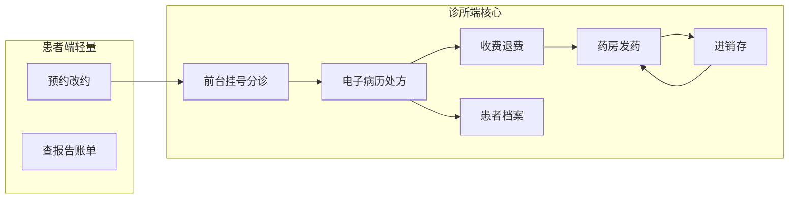
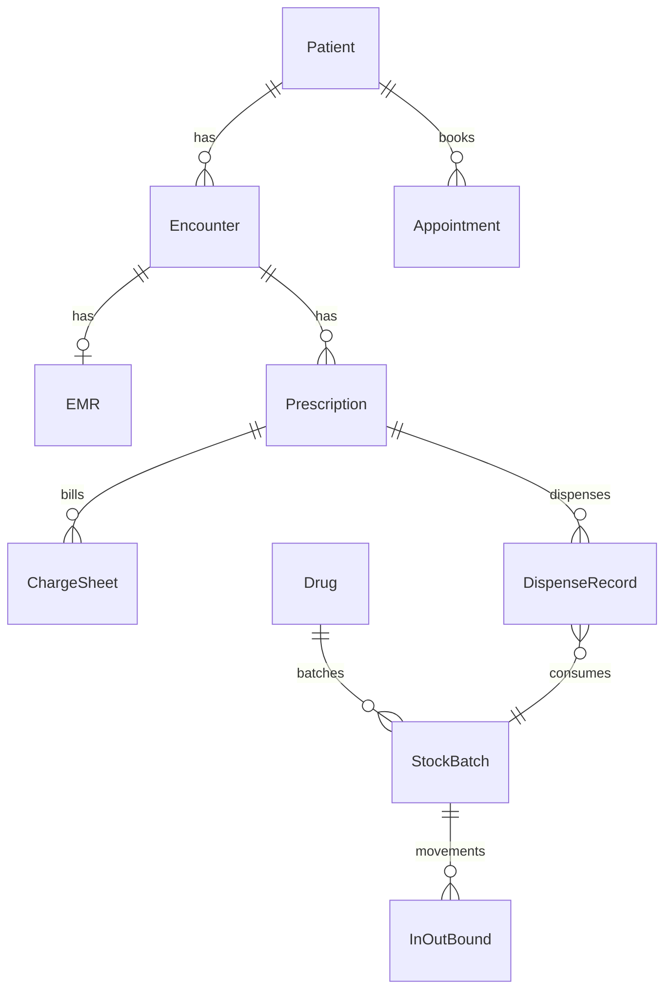
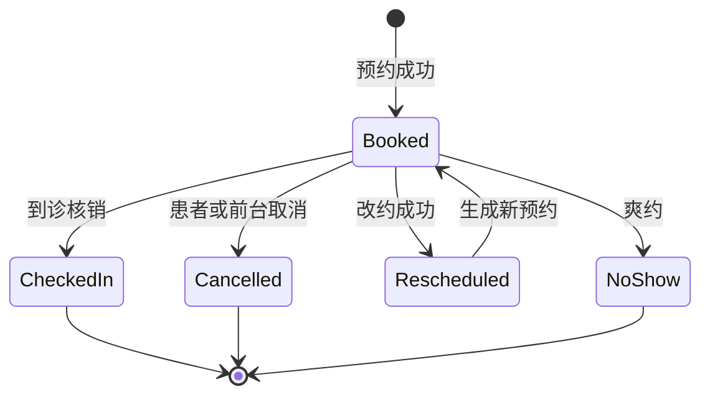
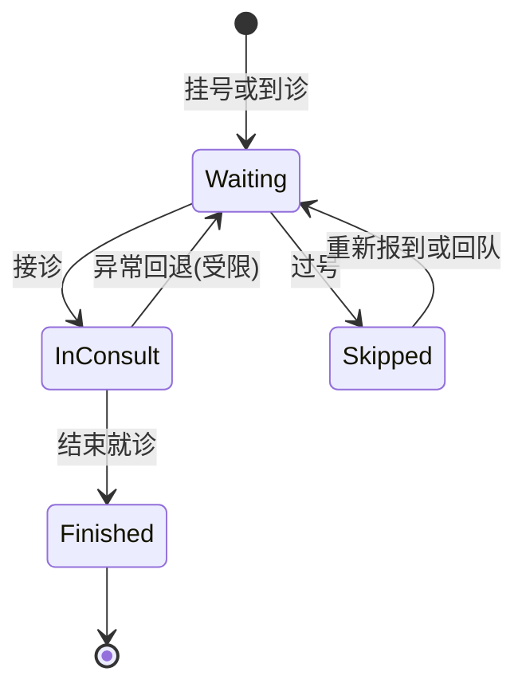
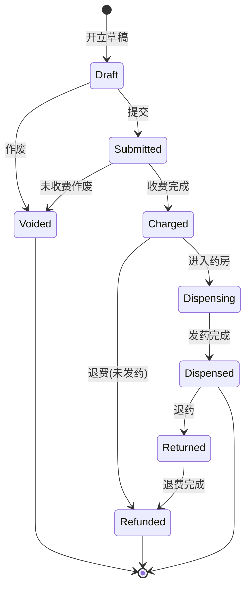
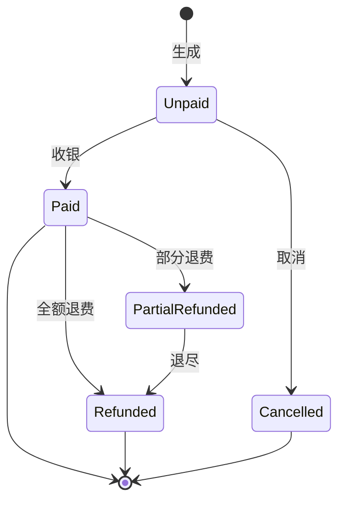

# 诊所管理系统 — 需求说明文档（SRS 轻量版）

| 项 | 内容 |
|---|---|
| 文档版本 | V1.0 |
| 状态 | 草稿 / 可评审 |
| 产品定位 | 单店诊所内部管理系统（轻量 HIS） |
| 适用对象 | 产品、研发、测试、诊所运营负责人 |
| 编写日期 | 2026-10-08 |
| 关联范围 | 线下到店门诊闭环；不含图文/视频问诊、多院区连锁、住院手术、复杂医保清算 |

---

## 1. 文档信息

### 1.1 修订记录

| 版本 | 日期 | 说明 | 作者 |
|---|---|---|---|
| V1.0 | 2026-10-08 | 首版：按「B 诊所内部管理 + 单店 + 无远程问诊」整理完整需求 | — |

### 1.2 术语表

| 术语 | 说明 |
|---|---|
| 号源 | 某医生/科室在某时段可预约或可挂号的名额 |
| 到诊核销 | 预约患者到达诊所后，前台确认到诊并转入候诊/就诊流程 |
| 接诊 | 医生开始为患者诊疗，打开/创建本次门诊病历 |
| 审方 | 药师对处方合理性、库存可配性进行审核 |
| 发药 | 药师按已收费且已审方（或免审配置）的处方配发药品并扣减库存 |
| 日结 | 财务按日汇总收银、退费与收费方式，完成对账锁定 |
| 近效期 | 药品距失效日期不足配置阈值（如 90/180 天） |
| MVP | 最小可上线版本，支撑单店门诊主闭环 |

### 1.3 范围边界（本期明确不做）

- 多院区 / 连锁集团管理、跨店调拨与统一结算
- 住院、手术麻醉、病区护理
- 图文问诊、视频问诊、互联网诊疗处方流转
- 复杂医保清算、商保直连（可预留扩展点）
- 第三方药品电商、患者端购药商城
- 复杂叫号大屏硬件深度对接（本期仅轻量叫号）

---

## 2. 项目概述

### 2.1 背景

中小型单店诊所信息化程度参差，常见痛点包括：预约与现场挂号割裂、病历手写难追溯、收费与发药不同步、库存与效期难管控、角色权限与操作审计缺失。需要一套以医护/行政为主、患者端轻量参与的内部管理系统，打通「预约 → 到诊 → 接诊开方 → 收费 → 发药 → 病历归档」，并并行支撑进销存。

### 2.2 产品目标

1. 支撑单店日常门诊全流程数字化，减少纸质单据与口头交接。
2. 保证处方、收费、库存三者状态一致，降低漏收、漏扣、错发风险。
3. 建立患者档案与就诊史，提升复诊效率与用药安全（过敏/重复用药提示分阶段落地）。
4. 提供基础经营报表与药品效期/库存预警，辅助运营决策。
5. 以角色权限与审计日志满足病历隐私与操作可追溯的基本合规要求。

### 2.3 成功标准（可验收）

| 编号 | 成功标准 |
|---|---|
| S1 | 患者可完成预约/改约/取消；前台可现场挂号与到诊核销 |
| S2 | 医生可完成接诊、写病历、开立西药处方并打印/导出 |
| S3 | 收费后药房可发药，发药自动扣减库存；库存不足有明确阻断或提示策略 |
| S4 | 库管可完成采购入库、盘点、近效期预警查询 |
| S5 | 不同角色仅能访问授权菜单与数据；关键操作有审计记录 |
| S6 | MVP 上线后，门诊主闭环无需依赖线下台账即可日清 |

### 2.4 用户与使用场景（摘要）

- **前台**：挂号、核销预约、引导候诊、协助建档。
- **医生**：叫号接诊、病历、开方、查阅历史。
- **药师**：审方、发药、退药、缺药处理。
- **库管**：入库、盘点、效期与上下限管理。
- **财务**：收银、退费、日结、收入查询。
- **管理员**：账号角色、基础字典、排班规则、系统参数。
- **患者（轻量端）**：预约挂号、改约/取消、查看报告与账单摘要（报告查看可放 V1.1）。

---

## 3. 用户与角色

| 角色 | 主要职责 | 典型权限 |
|---|---|---|
| 患者（C 端轻） | 预约/改约/取消；查看本人账单摘要、报告（分期） | 仅本人数据 |
| 前台 | 建档、现场挂号、预约核销、分诊辅助、基础咨询登记 | 患者档案、挂号预约、候诊队列只读/操作 |
| 护士/分诊 | 候诊队列维护、叫号协助、生命体征录入（可选） | 门诊队列、患者基本信息 |
| 医生 | 接诊、病历、诊断、开方、历史调阅 | 本科室/本人号源相关就诊；病历处方 |
| 药师 | 审方、发药、退药、处方查询 | 药房、库存只读、处方状态 |
| 库管 | 供应商、入库/退货、盘点、预警处理 | 进销存全量（单店） |
| 财务 | 收费、退费、日结、收费项目维护（可与管理员分担） | 收费、报表财务视图 |
| 诊所管理员 | 组织账号、角色权限、基础数据、系统参数、审计查阅 | 系统配置类全权限（业务操作可按需兼岗） |

说明：单店允许一人多角色；权限按「角色并集」生效。

---

## 4. 业务总览

### 4.1 门诊主闭环

### 4.2 端到端主流程（文字）

1. 管理员维护科室、医生、药品字典、收费项目、排班号源。
2. 患者端预约，或到店由前台现场挂号；预约患者到店后核销到诊。
3. 患者进入候诊队列；医生叫号/接诊，书写门诊病历并开立处方。
4. 前台/财务按挂号费、诊疗费、药品费等生成收费单并收银。
5. 药师审方（可配置是否强制）后发药，系统按批次策略扣减库存。
6. 病历归档；库管并行处理入库、盘点与效期预警；财务日终结账。

### 4.3 关键业务规则（全局）

| 编号 | 规则 |
|---|---|
| G1 | 一切诊疗行为必须关联「患者档案 + 本次就诊（Encounter）」 |
| G2 | 未收费处方默认不可发药（紧急 greencode 需管理员配置且审计） |
| G3 | 发药成功必须产生出库流水；退药成功必须回滚或冲正库存 |
| G4 | 病历与处方一经「提交/签发」后的修改需留痕（谁、何时、改了什么） |
| G5 | 单店模型：组织只有一个诊所主体，库存为一个逻辑库房（可物理分区字段预留） |

---

## 5. 功能需求

> 各模块结构：目标 → 功能列表 → 关键规则 → 非功能要点（如有）。

### 5.1 患者管理

**目标**：建立可复用的患者主索引，支撑复诊与用药安全信息沉淀。

**功能列表**

| ID | 功能点 | 说明 | 分期 |
|---|---|---|---|
| P-01 | 患者建档 | 姓名、性别、出生日期/年龄、手机号、证件号（可选）、地址等 | MVP |
| P-02 | 患者查询 | 按姓名/手机号/证件号/档案号模糊检索 | MVP |
| P-03 | 档案编辑 | 基本信息维护；关键字段变更可审计 | MVP |
| P-04 | 过敏史 / 慢病史 | 结构化条目 + 备注；接诊与开方时展示 | MVP |
| P-05 | 就诊史 | 按时间列出历史就诊、诊断摘要、处方摘要入口 | MVP |
| P-06 | 家属/联系人 | 紧急联系人姓名与电话 | MVP |
| P-07 | 备注与黑名单标记 | 内部备注；黑名单患者预约/挂号强提示 | MVP |
| P-08 | 档案合并 | 重复档案合并（主从选择、就诊记录迁移） | V1.1 |

**关键规则**

- 同一手机号允许多档案时须强提示疑似重复（姓名+手机号冲突）。
- 黑名单不物理删除数据，仅限制或提示业务操作。
- 患者端仅能查看本人授权范围内的摘要信息。

**非功能要点**：患者敏感字段（证件号、手机号）列表页脱敏展示。

---

### 5.2 预约挂号

**目标**：统一号源，覆盖线上预约与现场挂号，支持到诊核销与爽约统计。

**功能列表**

| ID | 功能点 | 说明 | 分期 |
|---|---|---|---|
| A-01 | 排班管理 | 按医生/科室配置出诊日期、时段、号源数量 | MVP |
| A-02 | 号源生成与冻结 | 根据排班生成可约号；支持停诊冻结号源 | MVP |
| A-03 | 患者端预约 | 选科室/医生/时段下单预约 | MVP |
| A-04 | 改约 / 取消 | 在规则允许时限内改约或取消并释放号源 | MVP |
| A-05 | 现场挂号 | 前台选择号源或加号策略完成挂号 | MVP |
| A-06 | 到诊核销 | 预约单核销为已到诊并进入候诊 | MVP |
| A-07 | 爽约处理 | 过号未到自动/手动记爽约；可统计 | MVP |
| A-08 | 预约查询 | 当日/历史预约列表筛选 | MVP |

**关键规则**

- 同一患者同一医生同一时段不可重复有效预约（可配置）。
- 取消/改约截止时间可配置（如就诊前 N 小时）。
- 号源扣减与释放必须原子：预约成功占号，取消/爽约/过期释放。
- 加号需有权限角色操作，并计入当日门诊量。

---

### 5.3 门诊就诊（候诊 / 叫号）

**目标**：轻量管理候诊队列与接诊状态，不做复杂硬件大屏对接。

**功能列表**

| ID | 功能点 | 说明 | 分期 |
|---|---|---|---|
| V-01 | 候诊队列 | 按科室/医生展示待诊、诊中、已诊 | MVP |
| V-02 | 叫号 / 过号 | 医生或分诊叫下一位；过号可回队尾或标记 | MVP |
| V-03 | 接诊开始/结束 | 变更就诊状态；关联病历会话 | MVP |
| V-04 | 队列筛选 | 按状态、关键字过滤 | MVP |

**关键规则**

- 仅「已到诊/已挂号」进入候诊。
- 同一就诊同时只能被一位医生接诊（锁定或状态互斥）。
- 过号策略可配置：回队尾 / 需重新报到。

---

### 5.4 电子病历

**目标**：支撑门诊病历书写、历史调阅与打印导出。

**功能列表**

| ID | 功能点 | 说明 | 分期 |
|---|---|---|---|
| E-01 | 创建/编辑门诊病历 | 主诉、现病史、既往史、查体、诊断、处置建议等 | MVP |
| E-02 | 常用诊断库 | 自由文本 + 常用诊断选择；ICD 编码可先可选填 | MVP |
| E-03 | 历史病历调阅 | 只读查看历史就诊病历 | MVP |
| E-04 | 病历提交/归档 | 提交后限制随意篡改，修改留痕 | MVP |
| E-05 | 打印 / 导出 PDF | 病历打印模板 | MVP |
| E-06 | 病历模板 | 按科室/病种模板一键带入 | V1.1 |
| E-07 | ICD 编码增强 | 诊断编码检索与必填策略可配置 | V1.1 |

**关键规则**

- 一份就诊对应一份主病历（可允许多次编辑至提交）。
- 归档后修改需记录修订版本或变更日志。
- 仅接诊医生及授权角色可编辑未归档病历。

**非功能要点**：病历访问写入审计；导出操作可记日志。

---

### 5.5 处方与医嘱

**目标**：西药处方开立与状态流转，为收费和发药提供依据。

**功能列表**

| ID | 功能点 | 说明 | 分期 |
|---|---|---|---|
| RX-01 | 开立西药处方 | 药品、规格、数量、用法、频次、天数、嘱托 | MVP |
| RX-02 | 处方保存/提交 | 草稿与提交；提交后进入待收费 | MVP |
| RX-03 | 处方作废 | 未收费可作废；已收费走退费退药链路 | MVP |
| RX-04 | 处方查询 | 按患者/日期/状态查询 | MVP |
| RX-05 | 过敏冲突提示 | 开方时对照患者过敏史提示 | V1.1 |
| RX-06 | 重复用药提示 | 同成分/同药品近期重复提示 | V1.1 |

**关键规则**

- 处方明细药品必须来自药品字典且状态启用。
- 库存为 0 时：开方可提示；发药阶段强校验（见药房/进销存）。
- 处方状态见附录状态机；不允许跳过非法流转。

---

### 5.6 收费管理

**目标**：完成挂号费/诊疗费/药品费等收银、退费与日结。

**功能列表**

| ID | 功能点 | 说明 | 分期 |
|---|---|---|---|
| C-01 | 收费项目字典 | 项目编码、名称、单价、类型（挂号/诊疗/其他） | MVP |
| C-02 | 生成收费单 | 汇总挂号、诊疗、处方药品金额 | MVP |
| C-03 | 收银 | 现金/微信/支付宝/银行卡等（可配置支付方式） | MVP |
| C-04 | 收费查询与票据打印 | 收费记录查询、简易收据打印 | MVP |
| C-05 | 部分/全额退费 | 与退药联动；需权限 | V1.1 |
| C-06 | 日结 | 按日汇总、对账、锁定当日收银 | V1.1 |
| C-07 | 患者端账单摘要 | 患者查看本人已支付账单摘要 | V1.1 |

**关键规则**

- 已全额退费的收费单不可重复收费；部分退费后余额可跟踪。
- 日结锁定后当日单据调整需反日结权限。
- 收费成功是发药的前置条件（除非紧急 greencode）。

---

### 5.7 药房管理

**目标**：审方、发药、退药与缺药处理，保证账实一致。

**功能列表**

| ID | 功能点 | 说明 | 分期 |
|---|---|---|---|
| PH-01 | 待发药队列 | 已收费待发药处方列表 | MVP |
| PH-02 | 审方 | 通过/驳回及原因；可配置是否跳过审方 | MVP |
| PH-03 | 发药 | 确认实发数量；扣库存；打印药签（可选） | MVP |
| PH-04 | 缺药处理 | 缺药标记、通知医生改方或退费 | MVP |
| PH-05 | 处方查询 | 历史发药记录 | MVP |
| PH-06 | 退药 | 已发药退回，冲正库存并触发退费流程 | V1.1 |

**关键规则**

- 发药数量不得超过处方数量；部分发药策略：MVP 可要求整方发完或整方挂起，V1.1 再支持细粒度。
- 发药扣减默认按近效期优先（FEFO）或批次手工选择（可配置）。
- 退药必须关联原发药单，防止无单回库。

---

### 5.8 进销存

**目标**：单店药品进销存闭环，支撑发药扣减与效期风险控制。

**功能列表**

| ID | 功能点 | 说明 | 分期 |
|---|---|---|---|
| I-01 | 供应商管理 | 供应商档案启用/停用 | MVP |
| I-02 | 采购入库 | 入库单：药品、批次、效期、数量、进价 | MVP |
| I-03 | 库存查询 | 实时库存、批次库存 | MVP |
| I-04 | 出入库流水 | 发药出库、入库、盘盈盘亏、退药回库等 | MVP |
| I-05 | 盘点 | 盘点单、差异调整 | MVP |
| I-06 | 近效期 / 上下限预警 | 列表与首页提醒 | MVP |
| I-07 | 采购退货 | 退货出库冲减批次库存 | V1.1 |
| I-08 | 调拨 | 单店弱化；同店库区调拨可选 | 后续 |

**关键规则**

- 批次 + 效期为库存最小管理单元。
- 不允许负库存发药（可配置：禁止 / 仅管理员强制并审计）。
- 盘点锁定期间限制对盘点药品的并发出库（或采用乐观校验）。

---

### 5.9 基础数据

**目标**：支撑业务运行的主数据维护。

| ID | 功能点 | 说明 | 分期 |
|---|---|---|---|
| M-01 | 科室 / 诊室 | 组织就诊单元 | MVP |
| M-02 | 医生档案 | 关联账号、科室、擅长、是否出诊 | MVP |
| M-03 | 药品字典 | 通用名、规格、单位、零售价、成本价、剂型、状态 | MVP |
| M-04 | 收费项目 | 见收费模块 | MVP |
| M-05 | 病历模板 | 模板维护 | V1.1 |
| M-06 | 打印模板 | 病历/处方/收据模板字段映射 | V1.1 |

**关键规则**：停用字典不可用于新开单，历史单据仍可展示快照名称。

---

### 5.10 权限与组织

**目标**：单店组织下的账号、角色、菜单与数据权限。

| ID | 功能点 | 说明 | 分期 |
|---|---|---|---|
| R-01 | 账号管理 | 启用/停用、重置密码 | MVP |
| R-02 | 角色与菜单权限 | RBAC；预置默认角色 | MVP |
| R-03 | 数据权限要点 | 医生默认看本人接诊；管理员看全店 | MVP |
| R-04 | 登录与会话 | 登录失败锁定策略可配置 | MVP |

**关键规则**：至少保留一名可用管理员；停用账号立即失效会话（理想）或短时过期。

---

### 5.11 统计报表

| ID | 报表 | 说明 | 分期 |
|---|---|---|---|
| RP-01 | 门诊量 | 按日/医生/科室 | MVP |
| RP-02 | 收入汇总 | 按项目类型/支付方式 | MVP |
| RP-03 | 药品进销存汇总 | 入库、出库、结存 | MVP |
| RP-04 | 预约转化 / 爽约 | 预约→到诊转化率 | V1.1 |
| RP-05 | 医生工作量 | 接诊量、处方量 | V1.1 |
| RP-06 | 近效期 / 滞销 | 运营预警报表 | MVP（近效期）/ V1.1（滞销） |

---

### 5.12 系统支撑

| ID | 功能点 | 说明 | 分期 |
|---|---|---|---|
| SYS-01 | 操作审计 | 登录、病历查看/导出、收费退费、库存调整等 | MVP（关键）/ V1.1（完善） |
| SYS-02 | 参数配置 | 改约时限、审方开关、近效期天数、库存策略等 | MVP |
| SYS-03 | 消息通知 | 到诊提醒短信/微信 | 后续可选 |
| SYS-04 | 患者端查报告 | 检验/检查报告查看（若有外送结果录入） | V1.1 |

---

## 6. 数据与权限

### 6.1 核心实体（逻辑）

| 实体 | 关键字段（逻辑） | 关系 |
|---|---|---|
| Patient | 档案号、姓名、手机号、过敏史… | 1 — N Encounter |
| Appointment | 号源、患者、状态、就诊时间 | 关联 Patient、ScheduleSlot |
| Encounter（就诊） | 患者、医生、科室、状态、挂号来源 | 1 — 1/N EMR；1 — N Prescription |
| EMR | 就诊、主诉…诊断、状态 | 属 Encounter |
| Prescription / Item | 药品、用法用量、状态 | 属 Encounter |
| ChargeSheet / Payment | 金额、支付方式、状态 | 关联 Encounter / Prescription |
| DispenseRecord | 发药明细、批次 | 关联 Prescription、StockBatch |
| Drug / StockBatch | 药品、批次、效期、数量 | 出入库流水引用 |
| InOutBound | 类型、数量、关联业务单 | 库存变动唯一凭证 |
| User / Role | 账号角色菜单 | RBAC |

### 6.2 角色权限矩阵（要点）

| 能力 \ 角色 | 患者 | 前台 | 护士 | 医生 | 药师 | 库管 | 财务 | 管理员 |
|---|---|---|---|---|---|---|---|---|
| 预约本人 | ✓ | | | | | | | |
| 建档/挂号/核销 | | ✓ | △ | | | | | ✓ |
| 候诊叫号 | | △ | ✓ | ✓ | | | | ✓ |
| 病历处方 | | | | ✓ | | | | ✓ |
| 收费退费 | | △ | | | | | ✓ | ✓ |
| 审方发药 | | | | | ✓ | | | ✓ |
| 进销存 | | | | | △只读 | ✓ | | ✓ |
| 报表 | | △ | | △本人 | △药品 | ✓ | ✓ | ✓ |
| 系统配置/审计 | | | | | | | | ✓ |

△ = 可选授权或只读。

---

## 7. 非功能需求

### 7.1 性能（单店量级参考）

| 场景 | 指标建议 |
|---|---|
| 页面常规查询 | P95 < 2s（局域网/常规宽带） |
| 候诊队列刷新 | 支持手动刷新；可选 10–30s 轮询 |
| 并发 | 支持约 20–50 内部用户同时在线（单店足够） |
| 日单据量 | 门诊数百单级流畅 |

### 7.2 安全与隐私

- 传输 HTTPS；密码哈希存储；会话超时。
- 病历、患者敏感信息按角色最小权限访问。
- 导出/打印病历记审计。
- 关键库备份与恢复策略由部署侧保障（文档要求具备备份能力）。

### 7.3 可用性

- 核心收银、发药流程步骤清晰，关键按钮防重复提交。
- 表单校验明确；库存不足、重复预约等错误可理解。
- 支持常见浏览器最新两个大版本。

### 7.4 审计与合规原则

- 病历保密、操作可追溯、药品效期可控为原则性要求。
- 不在本文展开医疗机构执业许可、互联网诊疗牌照等申请流程。
- 留存期限与本地法规对齐，由实施时配置。

### 7.5 打印与兼容

- MVP 支持浏览器打印；PDF 导出优先病历/处方。
- 打印模板 V1.1 可配置。

---

## 8. 分期建议

### 8.1 MVP

患者档案、排班号源、预约/现场挂号、到诊与候诊叫号、接诊 + 电子病历 + 开方、收费、发药扣库存、基础进销存（入库/盘点/预警）、角色权限、基础报表、关键审计。

### 8.2 V1.1

病历模板增强、合理用药提示（过敏/重复）、退费退药完整链路、日结、审计与打印完善、患者端查报告与账单摘要、档案合并、预约转化/工作量等报表。

### 8.3 后续可选

短信/微信通知、简易检验外送对接、电子发票、医保接口（单列风险与合规评估）、库区调拨细化、叫号大屏硬件对接。

---

## 9. 验收标准（按角色摘要）

### 9.1 前台

- [ ] 可为新患者建档并现场挂号成功占号
- [ ] 可为预约患者核销到诊并进入候诊
- [ ] 可处理取消预约后号源释放

### 9.2 医生

- [ ] 可从队列接诊并完成病历提交
- [ ] 可开立西药处方并看到状态变为待收费/后续状态
- [ ] 可调阅同一患者历史病历

### 9.3 财务

- [ ] 可对就诊生成收费单并完成收银
- [ ] 收费后药房可见待发药（联调）
- [ ] V1.1：可部分退费并日结锁定

### 9.4 药师

- [ ] 可对已收费处方发药并看到库存减少
- [ ] 库存不足时发药被阻断或按策略提示
- [ ] V1.1：可退药并冲正库存

### 9.5 库管

- [ ] 可入库指定批次与效期
- [ ] 可盘点调整并生成流水
- [ ] 可查看近效期预警列表

### 9.6 管理员

- [ ] 可配置角色菜单；停用账号后不可登录
- [ ] 可维护排班、药品与收费项目
- [ ] 可查询关键审计日志

### 9.7 患者端

- [ ] 可预约/改约/取消（在规则内）
- [ ] V1.1：可查看账单摘要与报告

---

## 10. 附录

### 10.1 核心状态机

#### 10.1.1 预约 Appointment

合法流转：`Booked → CheckedIn | Cancelled | NoShow | Rescheduled`。已核销不可直接取消（如需离开走就诊作废/退号流程，由门急诊规则定义）。

#### 10.1.2 就诊 Encounter

#### 10.1.3 处方 Prescription

#### 10.1.4 收费单 ChargeSheet

#### 10.1.5 库存单据 InOutBound

常见类型：`PurchaseIn`（采购入库）、`PurchaseReturn`（采购退货）、`DispenseOut`（发药出库）、`ReturnIn`（退药入库）、`StocktakeAdjust`（盘点调整）。

单据状态建议：`Draft → Posted → Voided(红冲)`；过账后改库存，作废用红冲单据保留审计链。

### 10.2 编号规则建议

| 单据 | 规则示例 | 说明 |
|---|---|---|
| 患者档案号 | `P` + yyyyMMdd + 4 位流水 | 店内唯一 |
| 预约单号 | `A` + yyyyMMdd + 4 位流水 | |
| 就诊号 | `E` + yyyyMMdd + 4 位流水 | |
| 处方号 | `RX` + yyyyMMdd + 4 位流水 | |
| 收费单号 | `CH` + yyyyMMdd + 4 位流水 | |
| 发药单号 | `DP` + yyyyMMdd + 4 位流水 | |
| 入库单号 | `IN` + yyyyMMdd + 4 位流水 | |
| 盘点单号 | `ST` + yyyyMMdd + 4 位流水 | |

流水按日重置或按全局序列均可，需保证单店唯一。

### 10.3 MVP / V1.1 功能勾选清单

#### MVP

- [ ] P-01~P-07 患者建档查询过敏史就诊史联系人备注黑名单
- [ ] A-01~A-08 排班号源预约改约取消现场挂号核销爽约查询
- [ ] V-01~V-04 候诊叫号过号接诊
- [ ] E-01~E-05 病历书写诊断库历史调阅提交打印导出
- [ ] RX-01~RX-04 开方提交作废查询
- [ ] C-01~C-04 收费字典收费单收银票据
- [ ] PH-01~PH-05 待发药审方发药缺药查询
- [ ] I-01~I-06 供应商入库库存流水盘点预警
- [ ] M-01~M-04 科室诊室医生药品收费项目
- [ ] R-01~R-04 账号角色数据权限登录
- [ ] RP-01~RP-03 门诊量收入进销存报表
- [ ] SYS-01（关键）SYS-02 审计与参数

#### V1.1

- [ ] P-08 档案合并
- [ ] E-06~E-07 病历模板与 ICD 增强
- [ ] RX-05~RX-06 过敏/重复用药提示
- [ ] C-05~C-07 退费日结患者端账单
- [ ] PH-06 退药
- [ ] I-07 采购退货
- [ ] M-05~M-06 病历/打印模板
- [ ] RP-04~RP-06 转化率工作量滞销等
- [ ] SYS-01 完善、SYS-04 患者端报告

#### 后续可选

- [ ] SYS-03 短信/微信通知
- [ ] 检验外送对接
- [ ] 电子发票
- [ ] 医保接口（独立合规评估）
- [ ] I-08 调拨细化 / 叫号大屏

### 10.4 实体关系示意说明

本附录仅作逻辑示意，不规定物理表结构、技术栈与 DDL。实施时可按微服务或单体拆分存储，但须保证：处方—收费—发药—库存流水的一致性边界清晰（同一事务或可靠出箱流程）。

---

**文档结束**
)
